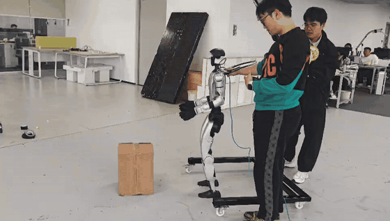
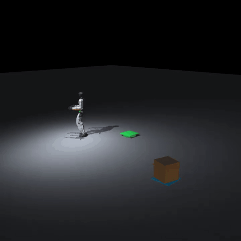
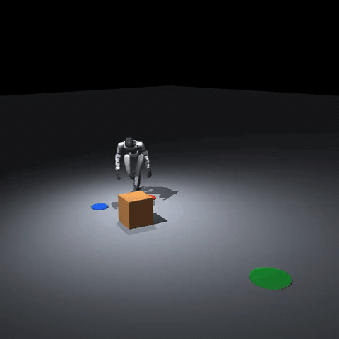
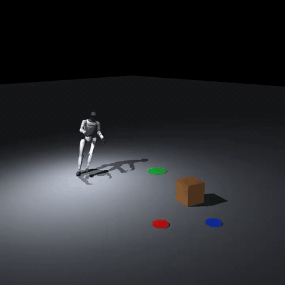

<p align="center">
  <a href="assets/real-robot/g1-carry-box.mp4">
    
  </a>
</p>

<h1 align="center">I-BFM</h1>

<p align="center">
  A G1 walks up to a cardboard box, picks it up, and carries it across the lab.<br>
  Carry, push, and kick share one policy.
</p>

<p align="center">
  <a href="assets/real-robot/g1-carry-box.mp4">Original video</a>
  &nbsp;·&nbsp;
  <a href="https://arxiv.org/abs/2610.06129">Paper</a>
  &nbsp;·&nbsp;
  <a href="https://iamhardworking.github.io/I-BFM/">Project site</a>
  &nbsp;·&nbsp;
  <a href="README.md">中文</a>
</p>

---

A task reward is enough. The policy picks its own command, so carry, push, and kick are not three separately trained networks. After a fall or a shove, it keeps taking the box where it needs to go.

The clip above is about 39 seconds. Open it for the original file with sound.

## Simulation

<table>
  <tr>
    <td align="center" width="33%"><b>Carry</b></td>
    <td align="center" width="33%"><b>Push</b></td>
    <td align="center" width="33%"><b>Kick</b></td>
  </tr>
  <tr>
    <td align="center"></td>
    <td align="center"></td>
    <td align="center"></td>
  </tr>
</table>

From `ibfm/`, all three scripts load the same 166.560M-step checkpoint.

```bash
./tasks/carry_box/run_interactive.sh
./tasks/push_box/run_interactive.sh
./tasks/kick_box/run_interactive.sh
```

## Run it

Linux, Python 3.10, `uv`, and MuJoCo. This repository has the code and the videos. The model weights are not included.

```bash
git clone https://github.com/HappyBigShark/I-BFM.git
cd I-BFM/ibfm
uv sync
```

To train again on eight H200 GPUs:

```bash
./scripts/train_ibfm_h200.sh ibfm_reproduction
```

Use `RESUME=1` after an interruption. Without a replay buffer from that same step, the continued run will not match an uninterrupted one.

The 166.560M-step replay buffer is on [Hugging Face](https://huggingface.co/datasets/HanSj77/I-BFM-166560M-replay-buffer): eight shards, about 210 GiB.

## Where things are

| Path | What |
| --- | --- |
| `ibfm/tasks/carry_box/` | Carry |
| `ibfm/tasks/push_box/` | Push |
| `ibfm/tasks/kick_box/` | Kick |
| `ibfm/tasks/carry_box/vision_distillation/` | Onboard-camera carry student. Weights are not included |
| `assets/real-robot/` | The real-robot clip above |
| `checkpoints/ibfm-166m/` | Checkpoint notes. The weight files are not in this repository |

License: [CC BY-NC 4.0](LICENSE).

```bibtex
@misc{han2026ibfm,
  title         = {{I-BFM}: Reward-Conditioned Robust Humanoid Interaction via Unsupervised Reinforcement Learning},
  author        = {Ziqi Han and Yitang Li and Junhan Sun and Fanrong Dong and Yaojie Shen and Lei Ye and Zetong Jing and Yongqi Zhang and Yiming Zhang and Xue Wang and Hao Zhao},
  year          = {2026},
  eprint        = {2610.06129},
  archivePrefix = {arXiv},
  primaryClass  = {cs.RO},
  url           = {https://arxiv.org/abs/2610.06129}
}
```
