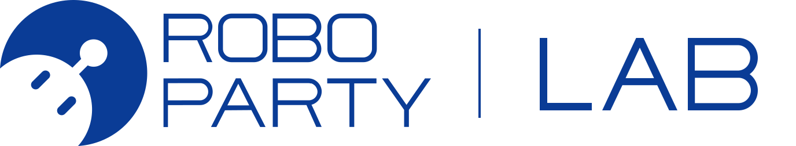
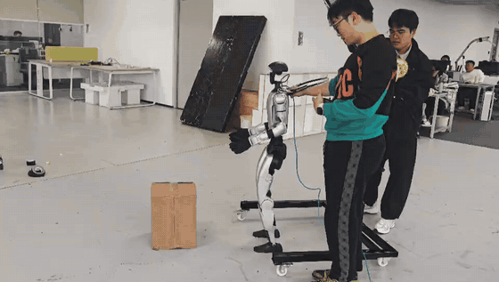
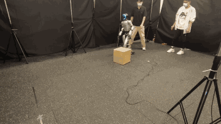
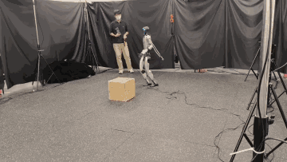
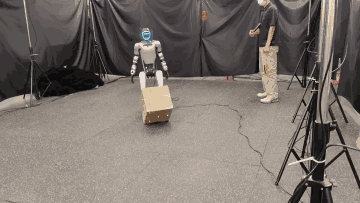
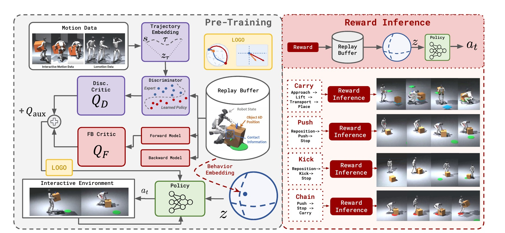
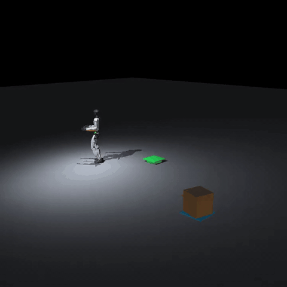
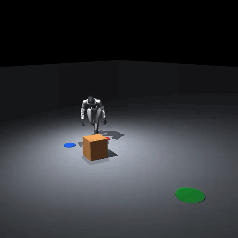
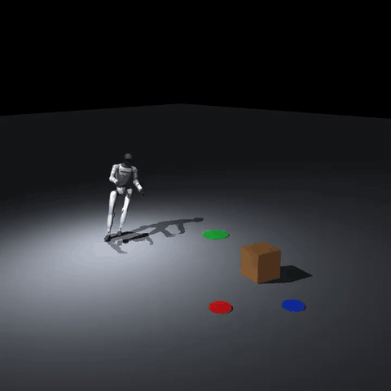

<p align="center">
  
</p>

<h1 align="center">I-BFM</h1>

<p align="center">
  <b>Reward-Conditioned Robust Humanoid Interaction</b><br>
  via Unsupervised Reinforcement Learning
</p>

<p align="center">
  <a href="https://arxiv.org/abs/2610.06129"></a>
  <a href="https://iamhardworking.github.io/I-BFM/"></a>
  <a href="https://huggingface.co/datasets/HanSj77/I-BFM-166560M-replay-buffer"></a>
  <a href="https://github.com/LeCAR-Lab/BFM-Zero"></a>
  <a href="LICENSE"></a>
</p>

<p align="center">
  <a href="README.md"><b>English</b></a>
  &nbsp;·&nbsp;
  <a href="README.zh-CN.md">简体中文</a>
</p>

<p align="center">
  Ziqi Han<sup>1,*</sup> &nbsp;·&nbsp;
  Yitang Li<sup>2,*</sup> &nbsp;·&nbsp;
  Junhan Sun<sup>3,*</sup> &nbsp;·&nbsp;
  Fanrong Dong<sup>3</sup> &nbsp;·&nbsp;
  Yaojie Shen<sup>4</sup> &nbsp;·&nbsp;
  Lei Ye<sup>5</sup><br>
  Zetong Jing<sup>3</sup> &nbsp;·&nbsp;
  Yongqi Zhang<sup>4,6</sup> &nbsp;·&nbsp;
  Yiming Zhang<sup>4</sup> &nbsp;·&nbsp;
  Xue Wang<sup>4</sup> &nbsp;·&nbsp;
  Hao Zhao<sup>2,4,†</sup>
</p>

<p align="center">
  <sup>1</sup> Tongji University &nbsp;·&nbsp;
  <sup>2</sup> Tsinghua University &nbsp;·&nbsp;
  <sup>3</sup> Zhejiang University<br>
  <sup>4</sup> RoboParty Lab &nbsp;·&nbsp;
  <sup>5</sup> Harbin Institute of Technology &nbsp;·&nbsp;
  <sup>6</sup> ShanghaiTech University<br>
  <sup>*</sup> Equal contribution &nbsp;·&nbsp; <sup>†</sup> Corresponding author
</p>

---

Behavioral foundation models can already drive diverse whole-body control, but physical interaction is harder: the humanoid, the object, and their contacts have to stay in one representation. **I-BFM** is, to our knowledge, the first behavioral foundation model for humanoid–object interaction. A single policy learns that coupled dynamics with forward–backward representations and unsupervised reinforcement learning. At test time, a task reward selects a latent command. The same policy then carries, pushes, or kicks, and keeps going after falls and disturbances, without a separate policy for each task.

<p align="center">
  <a href="assets/real-robot/g1-carry-box.mp4"><b>Real-robot video</b></a>
  &nbsp;&nbsp;·&nbsp;&nbsp;
  <a href="https://iamhardworking.github.io/I-BFM/"><b>Project website</b></a>
  &nbsp;&nbsp;·&nbsp;&nbsp;
  <a href="https://arxiv.org/abs/2610.06129"><b>Paper</b></a>
</p>

## Real robot

A Unitree G1 walks up to a cardboard box, lifts it with both hands, and carries it across the lab. The picture below plays the full 39-second clip. Open the original file for full resolution and sound.

<p align="center">
  <a href="assets/real-robot/g1-carry-box.mp4"></a>
</p>

<p align="center">
  <a href="assets/real-robot/g1-carry-box.mp4"><b>Play the original video</b></a>
</p>

## One policy, three interactions

Click a clip to open the full video on the project website.

<table>
  <tr>
    <td align="center" width="33%"><b>Carry Box</b><br><sub>Fall, stand up, and keep carrying</sub></td>
    <td align="center" width="33%"><b>Push Box</b><br><sub>Stay on the box after a shove</sub></td>
    <td align="center" width="33%"><b>Kick Box</b><br><sub>Move the box with the feet</sub></td>
  </tr>
  <tr>
    <td align="center"><a href="https://iamhardworking.github.io/I-BFM/#robust-carry-box"></a></td>
    <td align="center"><a href="https://iamhardworking.github.io/I-BFM/#robust-push-box"></a></td>
    <td align="center"><a href="https://iamhardworking.github.io/I-BFM/#robust-kick-box"></a></td>
  </tr>
</table>

The same **166.560M-step** checkpoint is used for all three tasks. It also supports goal reaching, motion tracking, stylistic control, and chaining skills over a longer horizon. On a Unitree G1, the policy recovers from interaction failures and external disturbances without task-specific retraining.

## Robustness

Success stays high when the box or the robot is disturbed. On Carry, nominal success is **94.3%**, and success after a fall is **89.3%**, compared with **1.3%** for a planning-based baseline.

| Condition | Carry | Push | Kick |
| --- | ---: | ---: | ---: |
| No external disturbance | 94.33% | 90.00% | 81.67% |
| Box disturbance | 91.00% | 85.33% | 79.67% |
| Robot disturbance | 89.33% | 84.67% | 86.67% |

## How it works

I-BFM pre-trains a shared interaction representation, then reads a downstream reward to pick the latent command. Short-horizon interaction targets and longer-horizon goals are trained together, so the same policy can both make contact and finish the task.

<p align="center">
  
</p>

<table>
  <tr>
    <td width="33%" valign="top"><b>One representation</b><br>Forward–backward latent dynamics cover the humanoid, the object, and contact, instead of a tracker per skill.</td>
    <td width="33%" valign="top"><b>Reward in, behavior out</b><br>A downstream reward conditions the frozen policy. No extra policy optimization is required for Carry, Push, or Kick.</td>
    <td width="33%" valign="top"><b>Two time scales</b><br>Short-horizon interaction targets and longer-horizon goals are trained together, which is what makes recovery and task chaining possible.</td>
  </tr>
</table>

## What is in this repository

| Path | What it is |
| --- | --- |
| `ibfm/` | Training source and the task runtime |
| `ibfm/tasks/carry_box/` | Carry Box script, controller, and latents |
| `ibfm/tasks/push_box/` | Push Box script, controller, and latents |
| `ibfm/tasks/kick_box/` | Kick Box scripts, controller, and latents |
| `ibfm/tasks/carry_box/vision_distillation/` | Onboard-camera student for Carry Box. Weight files are not included |
| `checkpoints/ibfm-166m/` | Metadata for the selected checkpoint. The weight is Git LFS, not a normal blob |
| `assets/real-robot/` | Real-robot carry clip on a Unitree G1 |

## Setup

Linux, Python 3.10, `uv`, Git LFS, and MuJoCo are required.

```bash
git clone https://github.com/Roboparty/I-BFM-Code.git
cd I-BFM-Code
git lfs install
git lfs pull
bash restore_checkpoint.sh
cd ibfm
uv sync
```

`git lfs pull` fetches the checkpoint parts. `restore_checkpoint.sh` checks them and assembles `checkpoints/ibfm-166m/model/model.safetensors`. Model weights (`*.safetensors`, `*.pt`, `*.pth`) are not stored as ordinary Git objects.

## Training

From `ibfm/`, on eight H200 GPUs:

```bash
./scripts/train_ibfm_h200.sh ibfm_reproduction
```

The launcher uses the published data mix, seed, and training parameters.

| Path | Role |
| --- | --- |
| `runs/ibfm_reproduction/checkpoint/` | Rolling checkpoint used to resume |
| `policies/latest` | Latest completed policy |
| `policies/best` | Lowest mean EMD over all 2,719 evaluation motions |

`policies/latest` and `policies/best` contain weights and configuration only. The replay buffer is written once, into the final rolling checkpoint, when training finishes normally.

Resume after an interruption:

```bash
RESUME=1 ./scripts/train_ibfm_h200.sh ibfm_reproduction
```

Without a replay buffer from the same step, the continued run will differ from an uninterrupted run.

## Interactive tasks

Run these from `ibfm/` after setup. Each script writes its own videos, traces, and summaries.

<table>
  <tr>
    <td align="center" width="33%">
      <b>Carry Box</b><br>
      <code>./tasks/carry_box/run_interactive.sh</code><br><br>
      
    </td>
    <td align="center" width="33%">
      <b>Push Box</b><br>
      <code>./tasks/push_box/run_interactive.sh</code><br><br>
      
    </td>
    <td align="center" width="33%">
      <b>Kick Box</b><br>
      <code>./tasks/kick_box/run_interactive.sh</code><br><br>
      
    </td>
  </tr>
</table>

## Replay buffer

The [166.560M-step replay buffer](https://huggingface.co/datasets/HanSj77/I-BFM-166560M-replay-buffer) is on Hugging Face: eight rank-local shards, about 210 GiB in total. From `ibfm/`:

```bash
uvx --from huggingface_hub hf download HanSj77/I-BFM-166560M-replay-buffer --repo-type dataset \
  --local-dir runs/ibfm_166560m_replay
```

Each of `runs/ibfm_166560m_replay/checkpoint/buffers/train_rank_0/` through `train_rank_7/` contains `buffer.hdf5` and `config.json`. `TrajectoryDictBufferMultiDim.load()` in `humanoidverse/agents/buffers/trajectory.py` reads one shard:

```bash
./.venv/bin/python - <<'PY'
from humanoidverse.agents.buffers.trajectory import TrajectoryDictBufferMultiDim

path = "runs/ibfm_166560m_replay/checkpoint/buffers/train_rank_0"
buffer = TrajectoryDictBufferMultiDim.load(path, device="cpu")
print(buffer.size())
PY
```

One shard is about 28 GB on disk and is loaded fully into memory. For latent selection during reward inference, pass a single rank directory to `humanoidverse/reward_inference.py` with `--buffer-path`.

## Community

Join the **Party-BFM** WeChat group to talk about I-BFM, LOGO, reproductions, and humanoid interaction. The QR code is replaced when the invitation expires.

<p align="center">
  
</p>

## License

The training source keeps the upstream [CC BY-NC 4.0](LICENSE) license.

## Citation

```bibtex
@misc{han2026ibfm,
  title         = {{I-BFM}: Reward-Conditioned Robust Humanoid Interaction via Unsupervised Reinforcement Learning},
  author        = {Ziqi Han and Yitang Li and Junhan Sun and Fanrong Dong and Yaojie Shen and Lei Ye and Zetong Jing and Yongqi Zhang and Yiming Zhang and Xue Wang and Hao Zhao},
  year          = {2026},
  eprint        = {2610.06129},
  archivePrefix = {arXiv},
  primaryClass  = {cs.RO},
  url           = {https://arxiv.org/abs/2610.06129}
}
```
