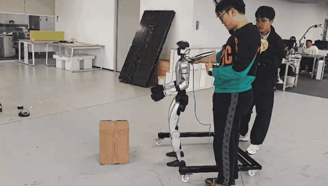

<p align="center">
  <a href="assets/real-robot/g1-carry-box.mp4">
    
  </a>
</p>

<p align="center">
  <a href="assets/real-robot/g1-carry-box.mp4">播放原视频</a>
</p>

# I-BFM

同一份策略用于搬箱、推箱和踢箱。本仓库是训练和交互代码，不包含模型权重。

[English](README.en.md)

## 运行

需要 Linux、Python 3.10、`uv` 和 MuJoCo。

```bash
git clone https://github.com/HappyBigShark/I-BFM.git
cd I-BFM/ibfm
uv sync
```

在 `ibfm/` 下：

```bash
./tasks/carry_box/run_interactive.sh
./tasks/push_box/run_interactive.sh
./tasks/kick_box/run_interactive.sh
```

三个任务使用同一次训练留下的 166.560M 步检查点。

## 训练

八张 H200：

```bash
./scripts/train_ibfm_h200.sh ibfm_reproduction
```

中断后用 `RESUME=1` 接着跑。没有同一时刻的 replay buffer 时，续训结果会和一次跑完不一样。

## 代码

| 路径 | 内容 |
| --- | --- |
| `ibfm/tasks/carry_box/` | 搬箱 |
| `ibfm/tasks/push_box/` | 推箱 |
| `ibfm/tasks/kick_box/` | 踢箱 |
| `ibfm/tasks/carry_box/vision_distillation/` | 机载相机的搬箱学生，权重未附 |
| `checkpoints/ibfm-166m/` | 检查点说明。权重文件不在这个仓库里 |

许可是 [CC BY-NC 4.0](LICENSE)。
