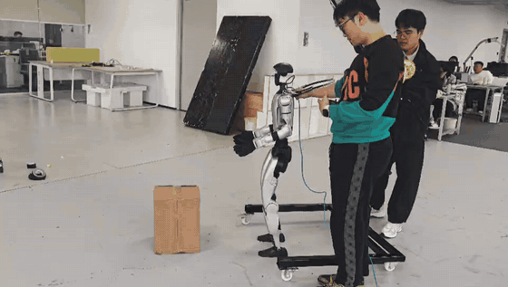
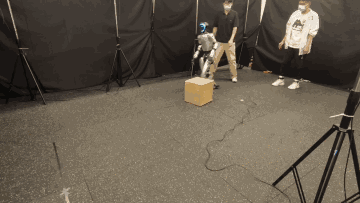
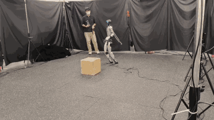
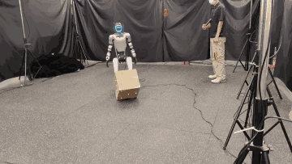
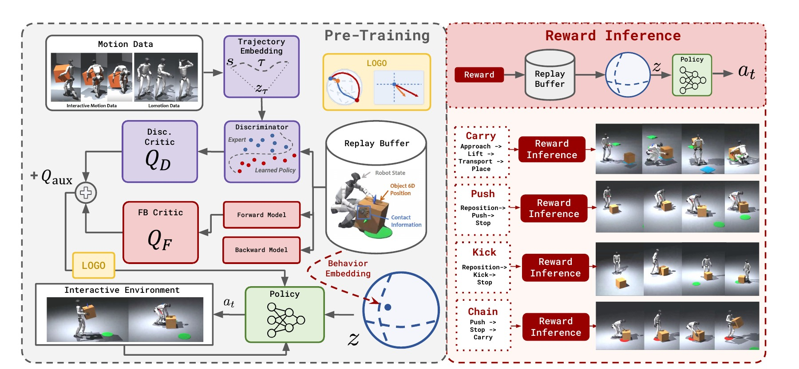
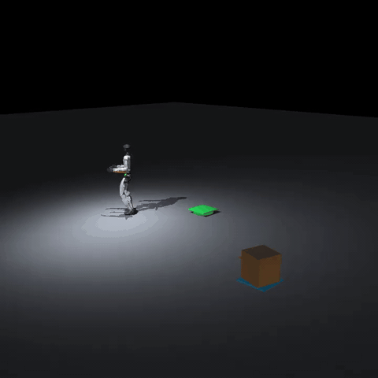
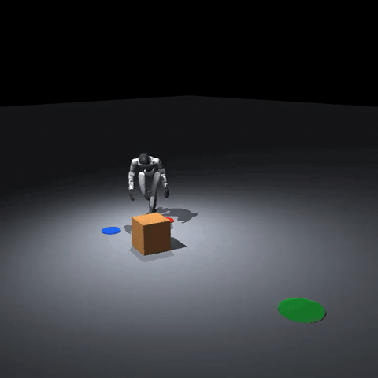
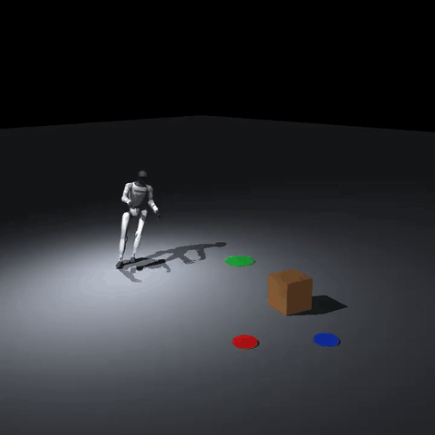

<p align="center">
  
</p>

<h1 align="center">I-BFM</h1>

<p align="center">
  <b>奖励条件化的鲁棒人形交互</b><br>
  基于无监督强化学习
</p>

<p align="center">
  <a href="https://arxiv.org/abs/2610.06129"></a>
  <a href="https://iamhardworking.github.io/I-BFM/"></a>
  <a href="https://huggingface.co/datasets/HanSj77/I-BFM-166560M-replay-buffer"></a>
  <a href="https://github.com/LeCAR-Lab/BFM-Zero"></a>
  <a href="LICENSE"></a>
</p>

<p align="center">
  <a href="README.md">English</a>
  &nbsp;·&nbsp;
  <a href="README.zh-CN.md"><b>简体中文</b></a>
</p>

<p align="center">
  Ziqi Han<sup>1,*</sup> &nbsp;·&nbsp;
  Yitang Li<sup>2,*</sup> &nbsp;·&nbsp;
  Junhan Sun<sup>3,*</sup> &nbsp;·&nbsp;
  Fanrong Dong<sup>3</sup> &nbsp;·&nbsp;
  Yaojie Shen<sup>4</sup> &nbsp;·&nbsp;
  Lei Ye<sup>5</sup><br>
  Zetong Jing<sup>3</sup> &nbsp;·&nbsp;
  Yongqi Zhang<sup>4,6</sup> &nbsp;·&nbsp;
  Yiming Zhang<sup>4</sup> &nbsp;·&nbsp;
  Xue Wang<sup>4</sup> &nbsp;·&nbsp;
  Hao Zhao<sup>2,4,†</sup>
</p>

<p align="center">
  <sup>1</sup> 同济大学 &nbsp;·&nbsp;
  <sup>2</sup> 清华大学 &nbsp;·&nbsp;
  <sup>3</sup> 浙江大学<br>
  <sup>4</sup> RoboParty Lab &nbsp;·&nbsp;
  <sup>5</sup> 哈尔滨工业大学 &nbsp;·&nbsp;
  <sup>6</sup> 上海科技大学<br>
  <sup>*</sup> 同等贡献 &nbsp;·&nbsp; <sup>†</sup> 通讯作者
</p>

---

行为基础模型已经能做多样的全身控制，但物理交互更难：人形、物体和接触必须放进同一种表示。**I-BFM** 据我们所知是第一个面向人形–物体交互的行为基础模型。它用前向–后向表示和无监督强化学习，学到这组耦合动力学。测试时，任务奖励选出一个潜变量指令，同一份策略就可以搬箱、推箱或踢箱，并在跌倒和扰动之后继续完成任务，不必为每个任务再训一个策略。

<p align="center">
  <a href="assets/real-robot/g1-carry-box.mp4"><b>真机视频</b></a>
  &nbsp;&nbsp;·&nbsp;&nbsp;
  <a href="https://iamhardworking.github.io/I-BFM/"><b>项目网站</b></a>
  &nbsp;&nbsp;·&nbsp;&nbsp;
  <a href="https://arxiv.org/abs/2610.06129"><b>论文</b></a>
</p>

## 真机效果

Unitree G1 走到纸箱前，双手把箱子抱起，再抱着箱子穿过实验室。下面播放的是完整的 39 秒片段。打开原视频可以看更清晰的画面，并听到声音。

<p align="center">
  <a href="assets/real-robot/g1-carry-box.mp4"></a>
</p>

<p align="center">
  <a href="assets/real-robot/g1-carry-box.mp4"><b>播放原视频</b></a>
</p>

## 一个策略，三种交互

点击预览可在项目网站观看完整视频。

<table>
  <tr>
    <td align="center" width="33%"><b>Carry · 搬箱</b><br><sub>跌倒后站起，继续把箱子送到目标</sub></td>
    <td align="center" width="33%"><b>Push · 推箱</b><br><sub>受到推动后仍沿箱子方向推进</sub></td>
    <td align="center" width="33%"><b>Kick · 踢箱</b><br><sub>用脚接触移动箱子，并调整站位</sub></td>
  </tr>
  <tr>
    <td align="center"><a href="https://iamhardworking.github.io/I-BFM/#robust-carry-box"></a></td>
    <td align="center"><a href="https://iamhardworking.github.io/I-BFM/#robust-push-box"></a></td>
    <td align="center"><a href="https://iamhardworking.github.io/I-BFM/#robust-kick-box"></a></td>
  </tr>
</table>

三个任务使用同一份 **166.560M 步**权重。它还支持目标到达、动作跟踪、风格控制和长时程技能串联。在 Unitree G1 上，策略可以在交互失败和外力扰动后恢复，无需按任务重新训练。

## 鲁棒性

箱子或机器人受到扰动时，成功率仍然保持。搬箱的名义成功率为 **94.3%**，跌倒后为 **89.3%**；作为对照，基于规划的基线在跌倒后只有 **1.3%**。

| 条件 | 搬箱 | 推箱 | 踢箱 |
| --- | ---: | ---: | ---: |
| 无外部扰动 | 94.33% | 90.00% | 81.67% |
| 箱子扰动 | 91.00% | 85.33% | 79.67% |
| 机器人扰动 | 89.33% | 84.67% | 86.67% |

## 方法

I-BFM 先预训练一个共享的交互表示，再用下游奖励选出潜变量指令。短时交互目标和长时目标一起训练，因此同一策略既能完成接触，也能把任务做完。

<p align="center">
  
</p>

<table>
  <tr>
    <td width="33%" valign="top"><b>一种表示</b><br>前向–后向潜变量动力学同时覆盖人形、物体和接触，而不是每个技能一条跟踪策略。</td>
    <td width="33%" valign="top"><b>奖励进，行为出</b><br>下游奖励直接调节已冻结的策略。搬箱、推箱、踢箱都不需要再做策略优化。</td>
    <td width="33%" valign="top"><b>两个时间尺度</b><br>短时交互目标和长时目标一起训练，恢复和任务串联都来自这里。</td>
  </tr>
</table>

## 仓库里有什么

| 路径 | 内容 |
| --- | --- |
| `ibfm/` | 训练源码和任务运行环境 |
| `ibfm/tasks/carry_box/` | 搬箱脚本、控制器和 latent |
| `ibfm/tasks/push_box/` | 推箱脚本、控制器和 latent |
| `ibfm/tasks/kick_box/` | 踢箱脚本、控制器和 latent |
| `ibfm/tasks/carry_box/vision_distillation/` | 搬箱的机载相机学生。权重文件不包含在内 |
| `checkpoints/ibfm-166m/` | 选定检查点的元数据。权重走 Git LFS，不是普通文件 |
| `assets/real-robot/` | Unitree G1 真机搬箱视频 |

## 安装

需要 Linux、Python 3.10、`uv`、Git LFS 和 MuJoCo。

```bash
git clone https://github.com/Roboparty/I-BFM-Code.git
cd I-BFM-Code
git lfs install
git lfs pull
bash restore_checkpoint.sh
cd ibfm
uv sync
```

`git lfs pull` 拉取检查点分片，`restore_checkpoint.sh` 校验后拼出 `checkpoints/ibfm-166m/model/model.safetensors`。模型权重（`*.safetensors`、`*.pt`、`*.pth`）不会作为普通 Git 对象提交。

## 训练

在 `ibfm/` 下使用 8 张 H200：

```bash
./scripts/train_ibfm_h200.sh ibfm_reproduction
```

启动脚本使用发布版的数据配比、随机种子和训练参数。

| 路径 | 作用 |
| --- | --- |
| `runs/ibfm_reproduction/checkpoint/` | 用于续训的滚动检查点 |
| `policies/latest` | 最新完成的策略 |
| `policies/best` | 2,719 条评估动作上平均 EMD 最低的策略 |

`policies/latest` 和 `policies/best` 只含权重与配置。训练正常结束时，replay buffer 只写入最终滚动检查点一次。

中断后续训：

```bash
RESUME=1 ./scripts/train_ibfm_h200.sh ibfm_reproduction
```

若没有同一训练步的 replay buffer，续训轨迹会与不中断的训练不同。

## 交互任务

安装完成后在 `ibfm/` 下运行。每个脚本会自己保存视频、轨迹和摘要。

<table>
  <tr>
    <td align="center" width="33%">
      <b>搬箱</b><br>
      <code>./tasks/carry_box/run_interactive.sh</code><br><br>
      
    </td>
    <td align="center" width="33%">
      <b>推箱</b><br>
      <code>./tasks/push_box/run_interactive.sh</code><br><br>
      
    </td>
    <td align="center" width="33%">
      <b>踢箱</b><br>
      <code>./tasks/kick_box/run_interactive.sh</code><br><br>
      
    </td>
  </tr>
</table>

## Replay buffer

[166.560M 步的 replay buffer](https://huggingface.co/datasets/HanSj77/I-BFM-166560M-replay-buffer) 在 Hugging Face 上，共 8 个 rank，约 210 GiB。在 `ibfm/` 下下载：

```bash
uvx --from huggingface_hub hf download HanSj77/I-BFM-166560M-replay-buffer --repo-type dataset \
  --local-dir runs/ibfm_166560m_replay
```

`runs/ibfm_166560m_replay/checkpoint/buffers/train_rank_0/` 到 `train_rank_7/` 每个目录都有 `buffer.hdf5` 和 `config.json`。`humanoidverse/agents/buffers/trajectory.py` 里的 `TrajectoryDictBufferMultiDim.load()` 读取单个 rank：

```bash
./.venv/bin/python - <<'PY'
from humanoidverse.agents.buffers.trajectory import TrajectoryDictBufferMultiDim

path = "runs/ibfm_166560m_replay/checkpoint/buffers/train_rank_0"
buffer = TrajectoryDictBufferMultiDim.load(path, device="cpu")
print(buffer.size())
PY
```

单个分片磁盘上约 28 GB，读取时会全部进入内存。做 reward inference 的 latent 选取时，把一个 rank 目录传给 `humanoidverse/reward_inference.py` 的 `--buffer-path`。

## 社区

欢迎加入 **Party-BFM 微信群**，交流 I-BFM、LOGO、复现和人形交互。邀请过期后会更换二维码。

<p align="center">
  
</p>

## 许可

训练源码沿用上游 [CC BY-NC 4.0](LICENSE) 许可。

## 引用

```bibtex
@misc{han2026ibfm,
  title         = {{I-BFM}: Reward-Conditioned Robust Humanoid Interaction via Unsupervised Reinforcement Learning},
  author        = {Ziqi Han and Yitang Li and Junhan Sun and Fanrong Dong and Yaojie Shen and Lei Ye and Zetong Jing and Yongqi Zhang and Yiming Zhang and Xue Wang and Hao Zhao},
  year          = {2026},
  eprint        = {2610.06129},
  archivePrefix = {arXiv},
  primaryClass  = {cs.RO},
  url           = {https://arxiv.org/abs/2610.06129}
}
```
